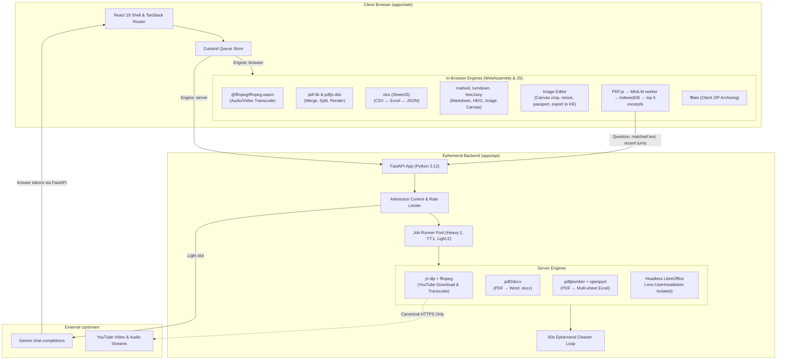

<div align="center">

# ConvertIt

**A minimal, ad-free web app for editing photos, chatting with PDFs and converting files between audio, video, image, PDF, document, spreadsheet and text formats. Most tools run entirely in your browser.**

[](https://www.typescriptlang.org/)
[](https://react.dev/)
[](https://vitejs.dev/)
[](https://tailwindcss.com/)
[](https://www.python.org/)
[](https://fastapi.tiangolo.com/)
[](https://playwright.dev/)
[](https://vitest.dev/)
[](#)

[Features](#-key-features) • [Image Editor](#-image-editor) • [Chat with PDF](#-chat-with-pdf) • [Architecture](#-architecture) • [Tools Catalogue](#-supported-tools-catalogue) • [Quickstart](#-quickstart) • [Docker](#-docker-deployment) • [Roadmap](docs/ROADMAP.md)

</div>

---

## 🌟 Key Features

- 🖼️ **Image Editor (home page):** Drop a photo to crop, resize, rotate and make passport photos, entirely in your browser. Export to a target file size for upload forms. [More below](#-image-editor).
- 💬 **Chat with PDF:** Ask questions about a PDF and get streamed answers with clickable page citations. The PDF is searched on your device; only the matching excerpts go to Gemini. [More below](#-chat-with-pdf).
- 🔒 **Private by Default:** Conversions run locally inside your browser whenever technically feasible via WebAssembly and client-side JavaScript. For those tools, **your files never leave your device**.
- 🏷️ **Radically Honest:** Every converter is explicitly badged with where execution occurs:
  - `● In your browser` (Green badge) — pure local processing.
  - `○ Server` (Neutral badge) — processed in an ephemeral backend.
  - `Best effort` — clearly marks complex document conversions.
- 🧹 **Zero State & Ephemeral:** The backend retains **no database and no logs of file names or URLs**. Output files are wiped automatically **60 seconds** after download or at the 15-minute TTL. The scratch disk is wiped on every server restart.
- 🪶 **Low-Resource Friendly:** Runs effortlessly on minimal hardware (as low as 512MB RAM and fractional CPUs) with admission control, rate-limiting, and `psutil` memory protection.
- ⚡ **Performance Engineered:** Dynamic asynchronous engine loading achieved a **75% reduction** in initial bundle size (from 1.85MB down to 463kB).
- 🚫 **No Distractions:** Zero ads, zero tracking cookies, no Google Fonts/CDNs, no analytics scripts, and no user accounts.
- 🎛️ **Dual Theme Support:** Meticulously crafted **Obsidian Utility** (dark) and **Utilitarian Precision** (light) palettes with system preference syncing and `⌘K` command navigation.

---

## 📸 Image Editor

The home page leads with a photo editor (`/tools/image-editor`). Drop a photo on the home page, or pick a shortcut card (Passport photo, Crop, Resize, Reduce to KB), and it opens with that photo loaded. Nothing is uploaded: decoding, cropping and encoding use the browser's canvas.

| Feature | Details |
|---|---|
| **Crop** | Drag handles or arrow keys. Presets: Free, 1:1, 4:5, 3:2, 16:9, 9:16. |
| **Social sizes** | Exact sizes for Instagram posts and stories, X/Twitter, Facebook, LinkedIn, YouTube thumbnails, banners and profile pictures. |
| **Passport photos** | India, US, UK, Schengen/EU, Canada and Australia sizes, with a face-guide oval sized to each country's head-height rule. Output at exact pixel size for 300 DPI. |
| **Print sheet** | Tiles as many passport copies as fit on a 6×4 in sheet, with cut lines. |
| **Rotate / flip / resize** | 90° rotation, horizontal and vertical flip, resize by pixels or percentage. |
| **Export** | JPG, PNG or WebP with a quality slider and a live size estimate. An optional **max file size (KB)** finds the highest quality that fits. |
| **Input** | JPG, PNG, WebP, AVIF, GIF, BMP and iPhone HEIC. EXIF orientation is applied. |

Passport sizes and head-height ranges are approximate guides. Check the official rules for the document you're applying for.

---

## 💬 Chat with PDF

Open **Documents → Chat with PDF**, choose a PDF with selectable text (up to 25 MB), then ask a question. Answers stream in with citations like `[p. 4]`; click one to open that page. **Stop** cancels generation.

**How it works**

1. **On your device:** PDF.js extracts the text. A browser worker splits it into page-numbered excerpts and embeds them with a quantized MiniLM model, served from this site. Excerpts and vectors are cached in IndexedDB, so reopening the same PDF is instant.
2. **Search:** each question is matched against the excerpts using embedding similarity plus exact keyword matches. The top five excerpts are selected.
3. **Answer:** the API forwards only the question, those excerpts and up to six recent messages to Gemini (`gemini-3.1-flash-lite` by default) and streams the answer back. ConvertIt does not log or store this content.

On the free tier, Google may use requests and responses to improve its products. See [Gemini API pricing and data use](https://ai.google.dev/gemini-api/docs/pricing#gemini-3.1-flash-lite).

**Troubleshooting**

| Message | What to do |
|---|---|
| *Could not run the local embedding model (…)* | The page already retries once with a fresh model download. If it still fails, press **Clear stored data** (it also clears the cached model) and try again. |
| *Invalid Gemini API Key* | Create a new key in [Google AI Studio](https://aistudio.google.com/apikey) and set `GEMINI_API_KEY` on the server. Gemini reports bad keys as HTTP 400, which the API maps to this message. |
| *Gemini Model Not Found* | `GEMINI_MODEL` names a model Google doesn't offer. Use a current model ID. |
| *Gemini Unavailable Here* | Google doesn't serve Gemini from the server's region. |
| *Gemini Rejected the Request* | The server log line `chat_provider_error` contains Google's exact message. |
| *Gemini Quota Exhausted* / *Rate Limit Reached* | The key hit its free-tier limit. Wait, or use another key. |

Password-protected PDFs need an unlocked copy. Scanned (image-only) PDFs need OCR first.

---

## 🏛️ Architecture



---

## 🛠️ Supported Tools Catalogue

The directory contains **40 tools**. The home page leads with the Image Editor; the YouTube downloader is listed under Video.

| Category | Tool | Input Format | Output Format | Engine |
|---|---|---|---|---|
| **Audio** | Audio Converter | MP3, WAV, AAC, OGG, FLAC, M4A | MP3, WAV, AAC, OGG, FLAC, M4A | In your browser (WASM) |
| **Video** | Video Converter | Video file | MP4, WebM | In your browser (WASM) |
| **Video** | Video to GIF | Video clip | GIF | In your browser (WASM) |
| **Video** | Extract Audio | MP4, MOV, AVI, MKV, WEBM | MP3, WAV, AAC, M4A | In your browser (WASM) |
| **Image** | Image Editor | JPG, PNG, WebP, AVIF, GIF, BMP, HEIC | JPG, PNG, WebP (crop, resize, rotate, passport, target KB) | In your browser (Canvas) |
| **Image** | Image Converter | PNG, JPG, WEBP, AVIF | PNG, JPG, WEBP | In your browser (Canvas) |
| **Image** | HEIC to JPG | HEIC, HEIF | JPG, PNG | In your browser (heic2any) |
| **Image** | Compress Image | PNG, JPG, WEBP | JPG, WebP, PNG at Low / Balanced / High, or under a target size in KB; never larger than the original | In your browser (Canvas) |
| **Image** | SVG to PNG | SVG | PNG, WebP (1×, 2×, 4×) | In your browser (Canvas) |
| **Image** | Resize Image | Image file | Resized image | In your browser (Canvas) |
| **Image** | Remove Background | Photos of people (JPG, PNG, WebP) | PNG/WebP with transparency, or a white/black background | In your browser (MODNet via ONNX) |
| **Image** | Remove Photo Metadata | JPG, PNG, WebP | Same format without EXIF/GPS/XMP, pixels untouched | In your browser |
| **PDF** | Rotate PDF | PDF | Rotated pages | In your browser (pdf-lib) |
| **PDF** | Remove PDF Pages | PDF + page list (e.g. `2, 5-7`) | PDF | In your browser (pdf-lib) |
| **PDF** | PDF to Text | Selectable PDF text | TXT | In your browser (pdfjs-dist) |
| **PDF** | Merge PDF | Multiple PDF files | Combined PDF | In your browser (pdf-lib) |
| **PDF** | Split / Extract PDF | PDF + range (e.g. `1-3, 5, 8-`) | One PDF of those pages, or `all` → one PDF per page (ZIP) | In your browser (pdf-lib) |
| **PDF** | PDF to Images | PDF document | PNG or JPEG per page at 72/150/300 DPI (ZIP for multi-page) | In your browser (pdfjs-dist) |
| **PDF** | Images to PDF | PNG, JPG, WebP images | Multi-page PDF, fit to A4 or original size | In your browser (pdf-lib) |
| **PDF** | Organize PDF Pages | PDF | Pages reordered (drag and drop), rotated or deleted | In your browser (pdf.js + pdf-lib) |
| **PDF** | Compress PDF | PDF | Smaller PDF: photos re-compressed, text kept | In your browser (pdf-lib) |
| **PDF** | OCR PDF | Scanned PDF | Searchable PDF (invisible text layer) or TXT; English | In your browser (tesseract.js) |
| **PDF** | Sign PDF | PDF | Drawn or typed signature, text and date placed on any page | In your browser (pdf.js + pdf-lib) |
| **PDF** | Protect PDF | PDF + password | AES-256 encrypted PDF | In your browser (qpdf WASM) |
| **PDF** | Unlock PDF | Protected PDF + its password | PDF without a password | In your browser (qpdf WASM) |
| **Data** | Excel to JSON | Workbook | JSON (first sheet, or all sheets keyed by name) | In your browser (SheetJS) |
| **Data** | JSON to Excel | JSON records | XLSX | In your browser (SheetJS) |
| **Data** | CSV to Excel | CSV | XLSX | In your browser (SheetJS) |
| **Data** | Excel to CSV | XLSX, XLS | CSV | In your browser (SheetJS) |
| **Data** | CSV to JSON | CSV | JSON objects, or row arrays when there's no header row | In your browser (SheetJS) |
| **Data** | JSON to CSV | JSON array of objects | CSV | In your browser (SheetJS) |
| **Text** | Markdown to HTML | Markdown (.md) | Clean HTML | In your browser (marked) |
| **Text** | HTML to Markdown | HTML file | Clean Markdown (.md) | In your browser (turndown) |
| **Documents** | Chat with PDF | PDF with selectable text | Streamed answer with clickable citations | Browser search, server generation (Gemini) |
| **Documents** | PDF to Word | PDF document | Word (.docx) | Server (pdf2docx) |
| **Documents** | PDF to Excel | PDF tables | Excel (.xlsx) or CSV; lattice or stream detection | Server (pdfplumber) |
| **Documents** | Word to PDF | DOCX, DOC | PDF | Server (LibreOffice) |
| **Documents** | Excel to PDF | XLSX, XLS | PDF | Server (LibreOffice) |
| **Documents** | PowerPoint to PDF | PPTX, PPT | PDF | Server (LibreOffice) |
| **Video** | YouTube Downloader (`/tools/youtube`) | Canonical URL | MP4 (1080p), MP3, M4A, Opus, WAV | Server (yt-dlp + ffmpeg), best effort |

---

## 🚀 Quickstart

### Prerequisites
- **Node.js:** v20.x or v22.x
- **Python:** 3.12+
- **FFmpeg:** Installed on your system (e.g. `brew install ffmpeg` or `apt install ffmpeg`)

### 1. Clone & Install Dependencies
```bash
git clone https://github.com/Joel-Joseph-George/convert-it.git
cd convert-it
npm install
```

### 2. Run the Backend API

To enable Chat with PDF, create a Gemini API key in [Google AI Studio](https://aistudio.google.com/apikey) and set it in `apps/api/.env` before starting the API. For free-tier usage, use a project on Google's free plan. The other tools work with the key omitted.

```dotenv
GEMINI_API_KEY=your_key_here
GEMINI_BASE_URL=https://generativelanguage.googleapis.com/v1beta/openai/
GEMINI_MODEL=gemini-3.1-flash-lite
```


```bash
cd apps/api
python3.12 -m venv .venv
source .venv/bin/activate
pip install -e ".[dev]"

# Start API on port 8000
uvicorn app.main:app --reload --port 8000
```

### 3. Run the Frontend App
```bash
# In a new terminal (root or apps/web)
cd apps/web
npm run dev
```
Open **[http://localhost:5173](http://localhost:5173)** in your browser.

See [Chat with PDF](#-chat-with-pdf) for how to use it. `npm run dev` and `npm run build` fetch the pinned MiniLM model into `public/vendor/models/` on first run (`npm run chat-assets -w web` does the same on its own, skipping files already present). The built site serves the model and WASM files from its own origin.

---

## 🐳 Docker Deployment

The repository includes a production-ready, multi-stage, non-root Dockerfile.

### Run with Docker Compose (Default In-Memory Queue)

Compose reads `GEMINI_API_KEY`, `GEMINI_BASE_URL` and `GEMINI_MODEL` from the repository-root `.env` or the shell. Copy `.env.example` to `.env` and replace the key placeholder to enable generation. Compose runs the API. Serve the frontend separately with its generated `vendor/` directory.

```bash
docker compose up --build
```

### Run with Redis Backend Profile
```bash
docker compose --profile redis up --build
```

### Build with Headless LibreOffice
```bash
docker build --build-arg INSTALL_LIBREOFFICE=true -t convertit-api apps/api
```

If your network uses a private CA for PyPI, pass a trusted public CA bundle to the build with `--secret id=pip_ca,src=/path/to/ca-bundle.pem`. BuildKit mounts it only while pip installs dependencies.

---

## 🧪 Testing & Verification

ConvertIt enforces strict quality gates across both frontend and backend.

```bash
# ------------------------------
# Frontend Verification
# ------------------------------
cd apps/web
npm run lint          # ESLint 9 (zero warnings allowed)
npm run type-check    # Strict TypeScript compilation (tsc --noEmit)
npm run test          # Vitest unit & component suites
npm run test:e2e      # Playwright browser end-to-end tests
npm run eval:retrieval # Top-5 hit rate on ten fixture questions
npm run build         # Production code-split bundle verification

# ------------------------------
# Backend Verification
# ------------------------------
cd apps/api
.venv/bin/ruff check app tests          # Ruff linter
.venv/bin/ruff format --check app tests # Ruff format verification
.venv/bin/mypy app tests                # Strict static type checker
.venv/bin/pytest                        # Full integration & golden test suite
.venv/bin/pip-audit                     # Dependency vulnerability audit
```

---

## 🎥 YouTube Operations & Smoke Test

YouTube frequently updates player configurations. Keep the installation fresh using the provided scripts:

```bash
# Verify YouTube extraction on candidate server IP
python scripts/youtube_smoke_test.py

# Bump yt-dlp to latest stable release
./scripts/bump_ytdlp.sh
```

---

## 📖 Documentation Index

- 📋 **[Project Roadmap & Backlog](docs/ROADMAP.md):** Completed items, upcoming features, and maintenance tasks.
- 📈 **[Progress Ledger](docs/PROGRESS.md):** Detailed step-by-step audit of Phases 0 through 6.
- 🎨 **[Design Notes & Tokens](docs/DESIGN_NOTES.md):** Obsidian Utility and Utilitarian Precision specifications.
- 🔌 **[API Documentation](docs/API.md):** Complete OpenAPI contract, admission controls, error codes, and SSE streaming specifications.
- 📦 **[Third-Party Inventory](docs/THIRD_PARTY.md):** Full list of dependencies, versions, and open-source licenses.

---

## 📜 License

Created for personal use. Private by default, tracking-free, and ad-free.  
All third-party libraries and licenses are catalogued in [docs/THIRD_PARTY.md](docs/THIRD_PARTY.md).
