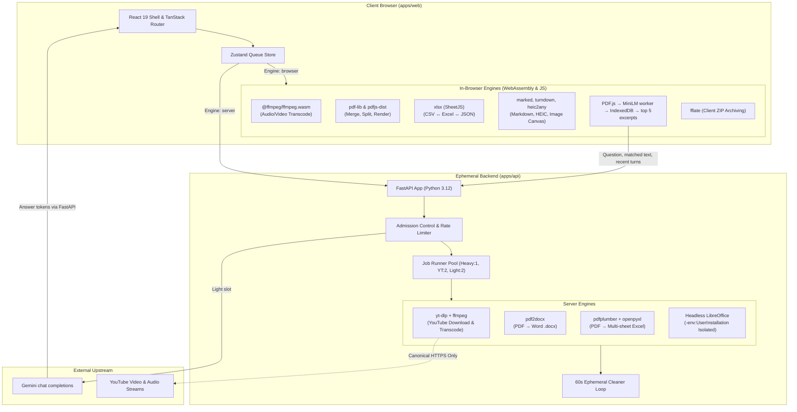

<div align="center">

# ConvertIt

**A minimal, ad-free personal web application for downloading YouTube media and converting files between multi-format audio, video, images, documents, spreadsheets, and text.**

[](https://www.typescriptlang.org/)
[](https://react.dev/)
[](https://vitejs.dev/)
[](https://tailwindcss.com/)
[](https://www.python.org/)
[](https://fastapi.tiangolo.com/)
[](https://playwright.dev/)
[](https://vitest.dev/)
[](#)

[Features](#-key-features) • [Architecture](#-architecture) • [Tools Catalogue](#-supported-tools-catalogue) • [Quickstart](#-quickstart) • [Docker](#-docker-deployment) • [Roadmap](docs/ROADMAP.md)

</div>

---

## 🌟 Key Features

- 🔒 **Private by Default:** Conversions run locally inside your browser whenever technically feasible via WebAssembly and client-side JavaScript. For those tools, **your files never leave your device**.
- 🏷️ **Radically Honest:** Every converter is explicitly badged with where execution occurs:
  - `● In your browser` (Green badge) — pure local processing.
  - `○ Server` (Neutral badge) — processed in an ephemeral backend.
  - `Best effort` — clearly marks complex document conversions.
- 🧹 **Zero State & Ephemeral:** The backend retains **no database and no logs of file names or URLs**. Output files are wiped automatically **60 seconds** after download or at the 15-minute TTL. The scratch disk is wiped on every server restart.
- 🪶 **Low-Resource Friendly:** Runs effortlessly on minimal hardware (as low as 512MB RAM and fractional CPUs) with admission control, rate-limiting, and `psutil` memory protection.
- ⚡ **Performance Engineered:** Dynamic asynchronous engine loading achieved a **75% reduction** in initial bundle size (from 1.85MB down to 463kB).
- 🚫 **No Distractions:** Zero ads, zero tracking cookies, no Google Fonts/CDNs, no analytics scripts, and no user accounts.
- 🎛️ **Dual Theme Support:** Meticulously crafted **Obsidian Utility** (dark) and **Utilitarian Precision** (light) palettes with system preference syncing and `⌘K` command navigation.

---

## 🏛️ Architecture



---

## 🛠️ Supported Tools Catalogue

The directory contains **30 tools**, including Chat with PDF. The home page also offers the YouTube downloader.

| Category | Tool | Input Format | Output Format | Engine |
|---|---|---|---|---|
| **Audio** | Audio Converter | MP3, WAV, AAC, OGG, FLAC, M4A | MP3, WAV, AAC, OGG, FLAC, M4A | In your browser (WASM) |
| **Video** | Video Converter | Video file | MP4, WebM | In your browser (WASM) |
| **Video** | Video to GIF | Video clip | GIF | In your browser (WASM) |
| **Video** | Extract Audio | MP4, MOV, AVI, MKV, WEBM | MP3, WAV, AAC, M4A | In your browser (WASM) |
| **Image** | Image Converter | PNG, JPG, WEBP, AVIF, BMP | PNG, JPG, WEBP | In your browser (Canvas) |
| **Image** | HEIC to JPG | HEIC, HEIF | JPG, PNG | In your browser (heic2any) |
| **Image** | Compress Image | PNG, JPG, WEBP | Compressed output | In your browser (Canvas) |
| **Image** | SVG to PNG | SVG | PNG | In your browser (Canvas) |
| **Image** | Resize Image | Image file | Resized image | In your browser (Canvas) |
| **PDF** | Rotate PDF | PDF | Rotated pages | In your browser (pdf-lib) |
| **PDF** | Remove PDF Pages | PDF | PDF | In your browser (pdf-lib) |
| **PDF** | PDF to Text | Selectable PDF text | TXT | In your browser (pdfjs-dist) |
| **PDF** | Merge PDF | Multiple PDF files | Combined PDF | In your browser (pdf-lib) |
| **PDF** | Split / Extract PDF | PDF document | Extracted PDF / Page ranges | In your browser (pdf-lib) |
| **PDF** | PDF to Images | PDF document | PNG, JPEG pages | In your browser (pdfjs-dist) |
| **PDF** | Images to PDF | Multiple PNG, JPG images | Multi-page PDF | In your browser (pdf-lib) |
| **Data** | Excel to JSON | Workbook | JSON | In your browser (SheetJS) |
| **Data** | JSON to Excel | JSON records | XLSX | In your browser (SheetJS) |
| **Data** | CSV to Excel | CSV | XLSX | In your browser (SheetJS) |
| **Data** | Excel to CSV | XLSX, XLS | CSV | In your browser (SheetJS) |
| **Data** | CSV to JSON | CSV | Formatted JSON | In your browser (SheetJS) |
| **Data** | JSON to CSV | JSON array of objects | CSV | In your browser (SheetJS) |
| **Text** | Markdown to HTML | Markdown (.md) | Clean HTML | In your browser (marked) |
| **Text** | HTML to Markdown | HTML file | Clean Markdown (.md) | In your browser (turndown) |
| **Documents** | Chat with PDF | PDF with selectable text | Streamed answer with clickable citations | Browser search, server generation (Gemini) |
| **Documents** | PDF to Word | PDF document | Word (.docx) | Server (pdf2docx) |
| **Documents** | PDF to Excel | PDF tables | Excel (.xlsx) | Server (pdfplumber) |
| **Documents** | Word to PDF | DOCX, DOC | PDF | Server (LibreOffice) |
| **Documents** | Excel to PDF | XLSX, XLS | PDF | Server (LibreOffice) |
| **Documents** | PowerPoint to PDF | PPTX, PPT | PDF | Server (LibreOffice) |
| **YouTube** | YouTube Downloader | Canonical URL | MP4 (1080p), MP3, M4A, Opus, WAV | Server (yt-dlp + ffmpeg) |

---

## 🚀 Quickstart

### Prerequisites
- **Node.js:** v20.x or v22.x
- **Python:** 3.12+
- **FFmpeg:** Installed on your system (e.g. `brew install ffmpeg` or `apt install ffmpeg`)

### 1. Clone & Install Dependencies
```bash
git clone https://github.com/Joel-Joseph-George/convert-it.git
cd convert-it
npm install
```

### 2. Run the Backend API

To enable Chat with PDF, create a Gemini API key in [Google AI Studio](https://aistudio.google.com/apikey) and set it in `apps/api/.env` before starting the API. For free-tier usage, use a project on Google's free plan. The other tools work with the key omitted.

```dotenv
GEMINI_API_KEY=your_key_here
GEMINI_BASE_URL=https://generativelanguage.googleapis.com/v1beta/openai/
GEMINI_MODEL=gemini-3.1-flash-lite
```


```bash
cd apps/api
python3.12 -m venv .venv
source .venv/bin/activate
pip install -e ".[dev]"

# Start API on port 8000
uvicorn app.main:app --reload --port 8000
```

### 3. Run the Frontend App
```bash
# In a new terminal (root or apps/web)
cd apps/web
npm run dev
```
Open **[http://localhost:5173](http://localhost:5173)** in your browser.

Open **Documents → Chat with PDF**, choose a selectable-text PDF up to 25 MB, then ask a question. Click a citation such as `[p. 4]` to view the original page. **Stop** cancels generation.

The first dev start or production build downloads a pinned MiniLM model from Hugging Face. The built site serves the model and WASM files from its own origin. PDF extraction, embedding and retrieval run on the device. IndexedDB retains the excerpts and vectors for reopening a PDF. **Clear stored data** erases all saved PDF indexes and the current conversation. The server forwards the question, up to five matching excerpts and up to six recent messages to Gemini. ConvertIt does not log or persist this content. On the free tier, Google may use requests and responses to improve its products. [Gemini API pricing and data use](https://ai.google.dev/gemini-api/docs/pricing#gemini-3.1-flash-lite)

---

## 🐳 Docker Deployment

The repository includes a production-ready, multi-stage, non-root Dockerfile.

### Run with Docker Compose (Default In-Memory Queue)

Compose reads `GEMINI_API_KEY`, `GEMINI_BASE_URL` and `GEMINI_MODEL` from the repository-root `.env` or the shell. Copy `.env.example` to `.env` and replace the key placeholder to enable generation. Compose runs the API. Serve the frontend separately with its generated `vendor/` directory.

```bash
docker compose up --build
```

### Run with Redis Backend Profile
```bash
docker compose --profile redis up --build
```

### Build with Headless LibreOffice
```bash
docker build --build-arg INSTALL_LIBREOFFICE=true -t convertit-api apps/api
```

If your network uses a private CA for PyPI, pass a trusted public CA bundle to the build with `--secret id=pip_ca,src=/path/to/ca-bundle.pem`. BuildKit mounts it only while pip installs dependencies.

---

## 🧪 Testing & Verification

ConvertIt enforces strict quality gates across both frontend and backend.

```bash
# ------------------------------
# Frontend Verification
# ------------------------------
cd apps/web
npm run lint          # ESLint 9 (zero warnings allowed)
npm run type-check    # Strict TypeScript compilation (tsc --noEmit)
npm run test          # Vitest unit & component suites
npm run test:e2e      # Playwright browser end-to-end tests
npm run eval:retrieval # Top-5 hit rate on ten fixture questions
npm run build         # Production code-split bundle verification

# ------------------------------
# Backend Verification
# ------------------------------
cd apps/api
.venv/bin/ruff check app tests          # Ruff linter
.venv/bin/ruff format --check app tests # Ruff format verification
.venv/bin/mypy app tests                # Strict static type checker
.venv/bin/pytest                        # Full integration & golden test suite
.venv/bin/pip-audit                     # Dependency vulnerability audit
```

---

## 🎥 YouTube Operations & Smoke Test

YouTube frequently updates player configurations. Keep the installation fresh using the provided scripts:

```bash
# Verify YouTube extraction on candidate server IP
python scripts/youtube_smoke_test.py

# Bump yt-dlp to latest stable release
./scripts/bump_ytdlp.sh
```

---

## 📖 Documentation Index

- 📋 **[Project Roadmap & Backlog](docs/ROADMAP.md):** Completed items, upcoming features, and maintenance tasks.
- 📈 **[Progress Ledger](docs/PROGRESS.md):** Detailed step-by-step audit of Phases 0 through 6.
- 🎨 **[Design Notes & Tokens](docs/DESIGN_NOTES.md):** Obsidian Utility and Utilitarian Precision specifications.
- 🔌 **[API Documentation](docs/API.md):** Complete OpenAPI contract, admission controls, error codes, and SSE streaming specifications.
- 📦 **[Third-Party Inventory](docs/THIRD_PARTY.md):** Full list of dependencies, versions, and open-source licenses.

---

## 📜 License

Created for personal use. Private by default, tracking-free, and ad-free.  
All third-party libraries and licenses are catalogued in [docs/THIRD_PARTY.md](docs/THIRD_PARTY.md).
